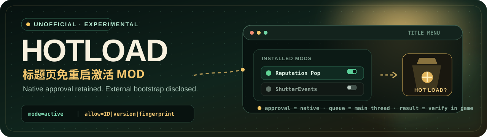
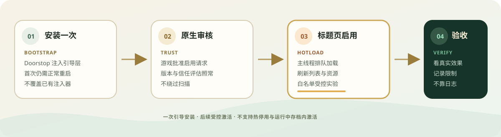

<p align="right">
  <a href="./README.md">简体中文</a> · <strong>English</strong>
</p>

<p align="center">
  
</p>

<p align="center">
  
  
  
  <a href="./LICENSE"></a>
</p>

<p align="center">
  <strong>Make a newly approved mod appear at the title screen.</strong><br>
  <sub>Title-screen activation without another launch · native approval retained · experimental source PoC</sub>
</p>

<p align="center">
  <a href="#why-hotload">Why</a> ·
  <a href="#how-it-works">How it works</a> ·
  <a href="#what-has-been-verified">Evidence</a> ·
  <a href="#build-from-source">Build</a> ·
  <a href="#safety-and-rollback">Safety</a> ·
  <a href="https://github.com/dragonpan2/probably-stolen-modding/issues/1">Developer request</a>
</p>

> [!WARNING]
> **Unofficial experiment.** This is not a one-click Workshop mod, and the developer has not endorsed third-party distribution or a Workshop companion. The tested entry point is the **title menu**. This snapshot does not support hot-disable, assembly unload, in-place DLL updates, or activation from inside a running save.

## Why HotLoad

Probably Stolen's native mod loader runs at startup. Enabling, downloading, or updating a mod often means leaving the game and coming back. HotLoad explores a different path: **reuse the native enable and approval flow, then pass an approved mod into the native loading path.**

| Conventional path | HotLoad experiment |
|---|---|
| Enable or download the mod | Enable or download the mod |
| See a restart requirement | Request loading from the title screen |
| Quit and relaunch | Refresh the list and observe whether the mod appears |
| Enter the game and check | Record the behavior and current limits |

HotLoad remains an external bootstrap. It does not bypass native approval, replace trust evaluation, or treat a `HOT LOADED` log line as proof that every asynchronous resource and callback completed.

## How it works



1. **Bootstrap at startup.** UnityDoorstop carries HotLoad into the process. The initial installation still requires one normal restart.
2. **Native approval remains in charge.** The game performs its own enable, version, and load-time trust checks.
3. **Queue loading on the main thread.** HotLoad calls the native folder-loading path and refreshes the mod list and resources.
4. **Verify visible behavior.** Compilation and logs are intermediate evidence. A title-screen activation counts only when checked in the game.

## What has been verified

See [docs/TESTING.md](docs/TESTING.md) for the public summary. It is an author-maintained local record, not an independently repeated test.

| Scenario | Recorded result | Boundary |
|---|---|---|
| Reputation Pop from the title screen | Player confirmed the pop appeared | One example of title-screen activation |
| Workshop item downloaded while running | ShowItemNames appeared and loaded | Actual item-label effect was not tested |
| ShutterEvents after returning to title | Events appeared after reloading the save | Not activation inside a running save |
| Repeated enable/disable | One initial load; disabling still required restart | No hot unload |
| Automatic eligibility | Eight local UI mods passed offline checks | Heuristic, not an all-mod compatibility promise |

> [!IMPORTANT]
> This source snapshot includes changes newer than some recorded game tests. **A successful build does not establish a new end-to-end game test.**

## Intended scope

| Better fit | Not promised |
|---|---|
| Title-screen activation of a single-entry UI mod | Activation inside a running save |
| Refresh after native approval | Bypassing scanning, approval, or version checks |
| Controlled tests with an allowlist | Arbitrary content mods, delayed startup, or reflection-only dependencies |
| Inspecting list state and actual behavior | Hot disable, unload, or DLL replacement |

Read [docs/LIMITATIONS.md](docs/LIMITATIONS.md) for partial-failure behavior, asynchronous completion boundaries, and the remaining heuristic gaps.

## Build from source

### 1. Preserve a recovery point

Exit through the game's normal save path. Back up `%USERPROFILE%\AppData\LocalLow\Questing Goose Studio\Probably Stolen` and record the existing game-root file list. This repository contains no saves, game DLLs, third-party mod binaries, or raw player logs.

### 2. Compile against your own game installation

Requirements: a legitimate game installation matching the tested APIs, PowerShell, and a .NET SDK that supports the SDK-style project.

```powershell
./build.ps1 -GameDir 'X:\SteamLibrary\steamapps\common\Probably Stolen'
```

The output is `out/HotLoad.dll`. The build script does not copy files into the game, launch it, or modify saves.

### 3. Installation is a separate manual step

<details>
<summary><strong>Expand: controlled installation order</strong></summary>

1. Check for an existing `winhttp.dll`, `doorstop_config.ini`, `HotLoad` directory, or another injector. Stop and resolve compatibility first.
2. Obtain [UnityDoorstop 4.5.0 for Windows x64](https://github.com/NeighTools/UnityDoorstop/releases/tag/v4.5.0) from the upstream release and follow its LGPL-2.1 terms.
3. Place `winhttp.dll`, `config/doorstop_config.ini`, `out/HotLoad.dll`, and `config/hotload.cfg` as documented.
4. Start with `mode=log`, then test `mode=hooks`, and only then use `mode=active`. Exit normally between bootstrap changes.
5. Keep `auto=off` for controlled experiments and bind the target to its real `ID|version|fingerprint`.
6. Select a UI mod that was disabled during startup and was not loaded. Enable it at the title screen, then verify visible behavior, one load record, and normal save entry.

</details>

> [!NOTE]
> Installing the bootstrap needs one restart. HotLoad improves the later **supported title-screen activation path**. Do not pass tests by disabling native scanning, enabling developer mode, or hiding loader access.

## Safety and rollback

- Modify only games and mods you are authorized to use.
- Use the pinned Doorstop release, not a third-party mirror.
- Do not publish game libraries, third-party mod binaries, saves, or raw player logs.
- Stop on partial failure; do not retry the same mod in that session.
- Remove only files you recorded adding. Do not recursively clean a shared game directory.
- Restoring a backup discards newer progress; use it only when that consequence is intended.

<details>
<summary><strong>Quick removal</strong></summary>

Exit the game and set `enabled=false` in the Doorstop configuration. For complete removal, delete only the files added by this experiment: `winhttp.dll`, `doorstop_config.ini`, `HotLoad/HotLoad.dll`, `HotLoad/hotload.cfg`, and any generated `HotLoad/hotload.log`; remove `HotLoad` only if it is empty. Steam file verification may leave added files in place.

</details>

## Reproduce with a local agent

Give [AGENT_REPRODUCE.md](AGENT_REPRODUCE.md) to Codex, DSH, or another local agent. The workflow starts with read-only inspection and a build, then presents exact installation targets, backup, and rollback for explicit review.

```text
Inspect this HotLoad experiment and the local game read-only.
Build it using README.md and AGENT_REPRODUCE.md, but do not install it.
Show the exact files, backup, and rollback plan, then wait for approval
before reproducing one UI mod from the title screen.
```

## Repository map

```text
.
├── assets/                 # README and article artwork
├── config/                 # HotLoad and Doorstop sample config
├── docs/
│   ├── BUILD_CHECK.md
│   ├── DEVELOPER_REQUEST.md
│   ├── LIMITATIONS.md
│   ├── OUTREACH_STATUS.md
│   └── TESTING.md
├── src/
│   ├── Eligibility.cs
│   ├── Hooks.cs
│   ├── HotLoad.cs
│   └── HotLoad.csproj
├── AGENT_REPRODUCE.md
├── SOURCE_MANIFEST.json
└── build.ps1
```

## Developer collaboration

An officially supported path is preferable. On 2026-10-30, [Issue #1](https://github.com/dragonpan2/probably-stolen-modding/issues/1) requested a title-screen refresh/activation API and clarification on GitHub distribution and a Workshop companion.

**Current status: request submitted; no developer endorsement has been received.** If an official API becomes available, this project should adapt to it or retire the external bootstrap. See [docs/DEVELOPER_REQUEST.md](docs/DEVELOPER_REQUEST.md).

## License

HotLoad's original source and documentation are MIT licensed; see [LICENSE](./LICENSE). Game code, assets, and libraries are not included or relicensed. UnityDoorstop is a separate LGPL-2.1 project and must be obtained under its own terms.

<p align="center">
  <sub>Built for careful experiments in a very suspicious pawnshop.</sub><br>
  <sub>For tinkerers, and for the next properly supported API.</sub>
</p>
