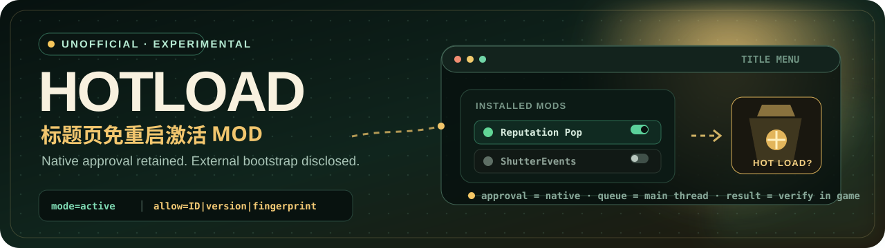
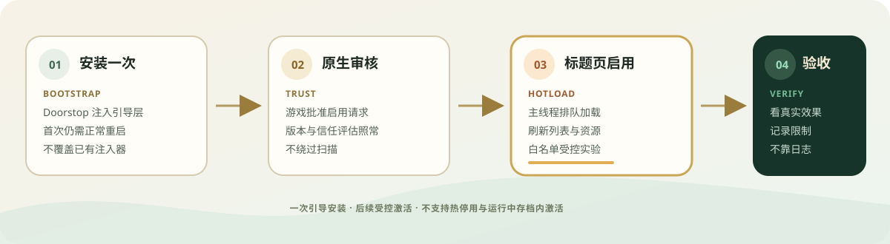

<p align="right">
  <strong>简体中文</strong> · <a href="./README.en.md">English</a>
</p>

<p align="center">
  
</p>

<p align="center">
  
  
  
  <a href="./LICENSE"></a>
</p>

<p align="center">
  <strong>让刚通过原生审核的 MOD，在标题页直接亮起来。</strong><br>
  <sub>标题界面免重启激活 · 保留原生审核与信任评估 · 实验性源码 PoC</sub>
</p>

<p align="center">
  <a href="#为什么是-hotload">为什么</a> ·
  <a href="#它是怎么工作的">工作方式</a> ·
  <a href="#已验证到哪一步">验证范围</a> ·
  <a href="#从源码开始">使用</a> ·
  <a href="#安全与回滚">安全</a> ·
  <a href="https://github.com/dragonpan2/probably-stolen-modding/issues/1">开发者申请</a>
</p>

> [!WARNING]
> **非官方实验项目。** 这不是订阅即用的工坊 MOD，也尚未取得开发者对第三方分发或工坊接入的认可。测试入口是**标题界面**；当前不支持热停用、卸载已加载程序集、原地更新 DLL，或从游戏存档内激活 MOD。

## 为什么是 HotLoad

《深空当铺》的原生 MOD 加载器在启动时工作。启用、下载或更新 MOD 后，常见路径是退出游戏再回来。HotLoad 实验的是另一段旅程：**复用原生启用与审核流程，然后把已获准的 MOD 送入原生加载路径。**

| 常规路径 | HotLoad 实验路径 |
|---|---|
| 启用或下载 MOD | 启用或下载 MOD |
| 看到“需要重启” | 在标题页请求加载 |
| 退出并重新启动游戏 | 刷新列表并观察 MOD 是否真正生效 |
| 再进入游戏检查结果 | 记录当前限制与失败边界 |

HotLoad 仍然是一个外部引导层。它不绕过原生审核，不替换信任判断，也不把“出现 HOT LOADED 日志”说成“MOD 已经完整运行”。

## 它是怎么工作的



1. **启动时注入引导层。** UnityDoorstop 将 HotLoad 带入进程；这一步仍需一次正常的初始安装与重启。
2. **原生流程继续负责批准。** 游戏完成原生启用、版本匹配与加载时信任评估。
3. **主线程排队加载。** HotLoad 在合适的时机调用原生文件夹加载路径，刷新 MOD 列表并加载资源。
4. **用真实游戏行为验收。** 日志和编译成功只是中间证据；最终以标题页激活后的可见效果为准。

## 已验证到哪一步

公开测试摘要记录于 [docs/TESTING.md](docs/TESTING.md)。这是维护者提供的本机测试记录，不是独立复现。

| 场景 | 记录结果 | 结论边界 |
|---|---|---|
| Reputation Pop 标题页激活 | 玩家确认飘字出现 | 支持“标题页激活可生效”的样本 |
| 运行中下载 Workshop 项 | ShowItemNames 出现在列表并载入 | 未验证物品标签的实际游戏效果 |
| 返回标题后启用 ShutterEvents | 重载存档后事件出现 | 不是运行中存档内激活 |
| 重复启用/停用 | 启用只载入一次，停用仍需重启 | 不支持把“开关”理解成热卸载 |
| 自动判定 | 8 个本地 UI MOD 通过离线检查 | 启发式，不是全 MOD 兼容承诺 |

> [!IMPORTANT]
> 当前源码快照包含比部分历史游戏测试更新的改动。**编译通过不等于完成新的端到端游戏验证。**

## 适合什么，不适合什么

| 更适合 | 暂不承诺 |
|---|---|
| 标题页启用单入口 UI MOD | 游戏存档运行中激活 |
| 在原生审核后刷新已安装项 | 绕过审核、扫描或版本匹配 |
| 对白名单 MOD 做受控实验 | 任意内容 MOD、延迟初始化或反射依赖 |
| 观察列表、信任记录和实际效果 | 热停用、热卸载、DLL 原地更新 |

逐项已知问题见 [docs/LIMITATIONS.md](docs/LIMITATIONS.md)。其中特别包括部分失败后的同会话重试、异步资源完成时机和自动判定的盲区。

## 从源码开始

### 1. 先看边界并保留恢复点

退出游戏，按原生方式保存。备份 `%USERPROFILE%\AppData\LocalLow\Questing Goose Studio\Probably Stolen`，并记录游戏根目录现有文件。GitHub 仓库不包含存档、游戏 DLL、第三方 MOD 二进制或原始日志。

### 2. 用自己的游戏安装编译

需要匹配测试 API 的本机游戏、PowerShell，以及支持 SDK 风格项目的 .NET SDK。

```powershell
./build.ps1 -GameDir 'X:\SteamLibrary\steamapps\common\Probably Stolen'
```

输出是 `out/HotLoad.dll`。构建脚本只编译，不复制进游戏、不启动游戏，也不修改存档。

### 3. 安装是独立的人工步骤

<details>
<summary><strong>展开：受控安装顺序</strong></summary>

1. 检查已有的 `winhttp.dll`、`doorstop_config.ini`、`HotLoad` 目录或其他注入器。发现冲突先停止，不要覆盖。
2. 从 [UnityDoorstop 4.5.0 Windows x64 官方发布页](https://github.com/NeighTools/UnityDoorstop/releases/tag/v4.5.0) 获取引导器，并遵守其 LGPL-2.1 许可。
3. 按仓库说明放置 `winhttp.dll`、`config/doorstop_config.ini`、`out/HotLoad.dll` 与 `config/hotload.cfg`。
4. 先用 `mode=log` 验证启动，再切到 `mode=hooks`，最后才进入 `mode=active`。每次改动都正常退出游戏。
5. 受控实验保持 `auto=off`，并为目标 MOD 绑定真实的 `ID|version|fingerprint`。
6. 选中一个已在启动时禁用、重新启动后未加载的 UI MOD，在标题页启用，检查可见效果、一次加载记录和正常存档进入。

</details>

> [!NOTE]
> 安装引导层需要一次游戏重启；HotLoad 优化的是**之后受支持的标题页激活流程**。不要通过禁用原生扫描、开发者模式或隐藏加载器访问来“让测试通过”。

## 安全与回滚

- 只处理你有权修改的游戏与 MOD。
- 不使用来源不明的 Doorstop 二进制或第三方镜像。
- 不把游戏库、第三方 MOD、存档或原始玩家日志上传到公开 Issue。
- 发生部分失败时，停止同一会话内的重试并退出游戏。
- 完整移除时，只删除自己逐项记录过的文件；不要递归清理或删除其他加载器。
- 恢复备份会丢弃之后的新进度，只在明确需要时执行。

<details>
<summary><strong>快速卸载</strong></summary>

退出游戏后，先把 Doorstop 配置中的 `enabled=false`。需要完整移除时，仅删除本次添加的 `winhttp.dll`、`doorstop_config.ini`、`HotLoad/HotLoad.dll`、`HotLoad/hotload.cfg` 和生成的 `HotLoad/hotload.log`；`HotLoad` 目录为空时再删除目录。Steam 的文件校验可能保留后加文件。

</details>

## 交给本地 Agent 复现

把 [AGENT_REPRODUCE.md](AGENT_REPRODUCE.md) 交给 Codex、DSH 或其他本地 Agent。它要求先只读检查、先编译、再说明具体安装目标、备份和回滚，最后等待用户批准。

```text
请先只读检查这个 HotLoad 实验项目及本机游戏是否匹配，
按 README 和 AGENT_REPRODUCE.md 编译；不要安装。
把具体安装目标、备份和恢复方案告诉我，
等我批准后再进行单个 UI MOD 的标题页复现。
```

## 仓库地图

```text
.
├── assets/                 # README 主视觉、流程和文章配图
├── config/                 # HotLoad 与 Doorstop 示例配置
├── docs/
│   ├── BUILD_CHECK.md      # 发布前构建检查
│   ├── DEVELOPER_REQUEST.md
│   ├── LIMITATIONS.md      # 必读限制
│   ├── OUTREACH_STATUS.md
│   └── TESTING.md          # 本机测试摘要
├── src/
│   ├── Eligibility.cs
│   ├── Hooks.cs
│   ├── HotLoad.cs
│   └── HotLoad.csproj
├── AGENT_REPRODUCE.md
├── SOURCE_MANIFEST.json
└── build.ps1
```

## 开发者协作

taffy 更希望这个能力由官方提供。2026-10-30 已向开发者的 MOD 仓库提交 [Issue #1](https://github.com/dragonpan2/probably-stolen-modding/issues/1)，申请官方标题页刷新/激活 API，并询问 GitHub 外部分发与工坊配套的许可。

**目前状态：申请已发出，尚无开发者认可。** 若获得官方接口，本项目应优先适配或退休外部引导层。完整申请见 [docs/DEVELOPER_REQUEST.md](docs/DEVELOPER_REQUEST.md)。

## 来源与许可

HotLoad 的原创源码与文档以 [MIT](./LICENSE) 发布。游戏代码、素材和库不在仓库中，也不随本项目重新授权。UnityDoorstop 是独立的 LGPL-2.1 项目，需要从其官方渠道获取并遵守其许可。

<p align="center">
  <sub>Built for careful experiments in a very suspicious pawnshop.</sub><br>
  <sub>给爱折腾的人，也给下一次真正的官方 API。</sub>
</p>
